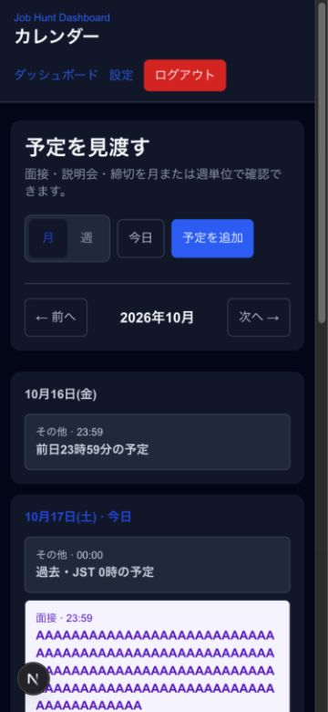
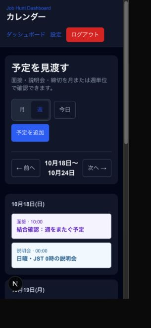
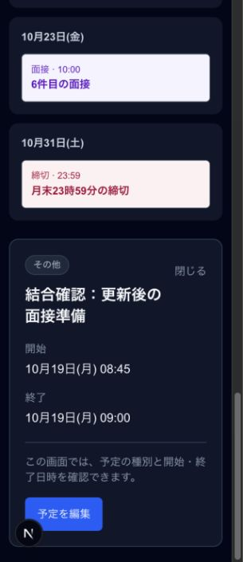

# 16 カレンダー結合確認（Issue #38）

## 結論・方針

- 直近予定はダッシュボードの「次の7日間・最大5件」と、カレンダーの月/週表示から確認する。
- タスク期限は今回表示しない。イベントとの違い・重複の扱い・延期範囲と追跡先 #20、#28との期間定義は [連携方針](./13_カレンダー・タスク連携方針.md) に記載。
- スマホ幅で月/週の予定と詳細、保存後のダッシュボード連携を下記のとおり操作確認した。コードの存在だけによる判定ではない。

## 実施環境と検証の限界

- 実施日: 2026-10-17（JST）。#36 / #37 のマージ済みmain `4beeeb4` を取り込んだ #38 ブランチ。
- Next.js 16.2.6 / Node.js 24.21.0、ローカル開発サーバーとChromiumベースのアプリ内ブラウザ。
- 通常のログイン、Supabase SDK、Server Actionsを使用。`CALENDAR_PREVIEW=false`。接続先のみ `127.0.0.1` 上の検証用Auth/PostgREST互換fixtureに切り替え、イベントをPGliteへ永続保存した。
- データはすべて合成した検証データ。実ユーザーの情報・本番Supabaseのデータは使用・変更していない。fixtureは本番のSupabase/RLSや認証サービスを再現するものではない。
- 以下はアプリの画面・保存処理・取得条件のローカル結合確認であり、実Supabaseの認証/RLS、公開URL、iOS Safari/Android実機の確認結果ではない。これらは後続の [#23](https://github.com/team-diamond-2026/jobhunt_notion_dev_memo/issues/23) で実施する。

## 画面幅と結果

| 設定viewport | 実測clientWidth / scrollWidth | 操作・結果 |
| --- | --- | --- |
| 320 × 740 | 305 / 305 | 月一覧、週一覧7日分、120文字英数字の詳細、月/週切替、前後期間、作成・編集を操作。横スクロールなし |
| 375 × 812 | 360 / 360 | ダッシュボード、月一覧、週一覧、詳細を操作。日付・予定名・種別・開始/終了を確認可能 |
| 1280 × 800 | 1265 / 1265 | PC月表示は7列グリッドを維持。長いタイトルはセル内で省略、詳細で全文確認可能 |

clientWidthが設定viewportより15px小さいのは検証ブラウザの縦スクロールバー分。横あふれは `document.documentElement.scrollWidth <= clientWidth` とスクリーンショットで確認した。スマホ実機の測定値とは区別する。

## 操作手順・確認結果

検証データは、直近7日以内に6件、過去2件、月末23:59、翌月1日0:00の予定を準備した。1件の予定名は英数字120文字とした。

| ケース | 手順 | 結果 |
| --- | --- | --- |
| 直近予定と上限 | ログイン→ダッシュボードの「直近の予定」を開く | 開始順に5件。過去予定と6件目は表示しない。最大5件の説明とカレンダー導線を表示 |
| 6件目の確認 | カレンダー→10月→10/23 | ダッシュボードから省略した「6件目の面接」を確認できる |
| 詳細の連携 | ダッシュボードの予定を選ぶ→週詳細→月→週 | 開始日を含む期間と同じevent IDの詳細へ遷移。月/週の切替でも詳細を保持 |
| 長い予定名 | 120文字英数字の予定を320/375pxで開く | 一覧・詳細で折り返し、閉じる・編集リンクも画面内。横あふれなし |
| 通常の作成 | 「予定を追加」で10/18 09:00〜10:00、関連企業付きの予定を保存 | INSERT 1行を確認。保存した日の月詳細に遷移。ダッシュボードにも同じタイトル・日時が反映 |
| 通常の編集と永続化 | 詳細→編集→名称・日時を10/19 08:30〜09:00へ変更→再読み込み→ダッシュボード | PATCH 1行を確認。更新したタイトルと日時を両画面で表示。main統合後も08:45へ再編集し、再読み込み後の保持を確認 |
| JST日/週境界 | 10/17 23:59と10/18(日)0:00の予定を前後週で確認 | 10/17は前週、10/18は翌週の日曜。0:00が前日にずれない |
| 月境界 | 10月の月末予定を確認→次の月 | 10/31 23:59は10月、11/1 0:00は11月のスマホ一覧に表示 |
| 複数日予定（main修正の回帰） | 10/17 10:00〜10/19 0:00をフォームで保存→翌週へ移動 | 10/18にも予定を表示、終了した10/19には重複表示しない |
| 保存エラー（main修正の回帰） | 終了を開始より前にして送信→日時を修正して再送信 | エラーと入力済み名称・日時を保持。修正後に保存成功 |
| 0件 | fixtureのイベントGETだけを空配列へ切替え、各画面を再読み込み | ダッシュボード「直近の予定はありません」、月「この月の予定はありません」、週は7日すべて「予定なし」 |
| 取得失敗 | fixtureのイベントGETだけを503へ切替え、各画面を再読み込み | 両画面で取得失敗と再読み込み案内。予定0件と混同せず、企業表示は継続 |
| 本番プレビューの無効化 | production buildを `CALENDAR_PREVIEW=true` で起動し、Cookieなしで `/calendar` を取得 | HTTP 307で `/login` へ遷移。開発用フラグが本番の認証を迂回しない |

fixtureの空/失敗モードでは保存データを削除せず、検証後は通常モードへ戻した。削除操作と別ユーザー間アクセス制御はこの記録で確認済みとは扱わない。

## 再確認方法

1. #36 / #37 とこのPRを含むブランチで `cd app && npm ci`。Node.js 22.6以降（今回の実施版は24.21.0）を使用する。
2. 検証専用Supabase環境に既存マイグレーションを適用し、検証ユーザー・企業を用意する。本番環境でテストデータを作成しない。
3. その環境のURL/anon keyをローカル環境変数に設定し、`CALENDAR_PREVIEW` は未設定または `false` で `npm run dev` を起動する。
4. 上記データを予定作成画面から登録する。別日に実施する場合、直近6件を現在から7日以内、日/週/月境界は確認対象の日付へ置き換える。
5. ブラウザのレスポンシブ表示を320×740、375×812、1280×800に設定し、上表の操作を実行する。保存後は再読み込みし、ダッシュボードと月/週の同一ID・日時を確認する。
6. 空状態は予定のない検証ユーザーまたは期間、取得失敗はローカルのHTTP fixture等を使う。本番RLSや接続設定を壊して試さない。
7. #23では実機・実Supabaseで同じ手順に加え、ログアウト時の遮断、別ユーザー間の隔離、公開URLを確認する。

ローカルfixtureは通常画面とServer Actionsを通すための一時的な検証アダプターであり、製品コードには含めていない。上記の検証専用Supabaseでの再確認は、本記録のfixtureによる結果とは別の確認になる。

## 自動確認

`app/` で実行:

```sh
npm run test:calendar
TZ=America/Los_Angeles npm run test:calendar
npm run lint
npm run build
```

- テスト: 両タイムゾーンで18件成功（追加12件 + main由来6件）。JST日付、月末/年末/閏年、日曜境界、7日exclusive、詳細URL、複数日予定、フォーム入力保持を含む。
- lint / production build: 成功。
- NodeのTypeScript直接読み込みで `MODULE_TYPELESS_PACKAGE_JSON` 警告が出るが、テスト失敗ではない。アプリ全体のmodule設定は変更しない。

## スクリーンショット（合成データ）

| 月表示 375px | 週表示 320px | 保存・再読み込み後の詳細 320px |
| --- | --- | --- |
|  |  |  |
