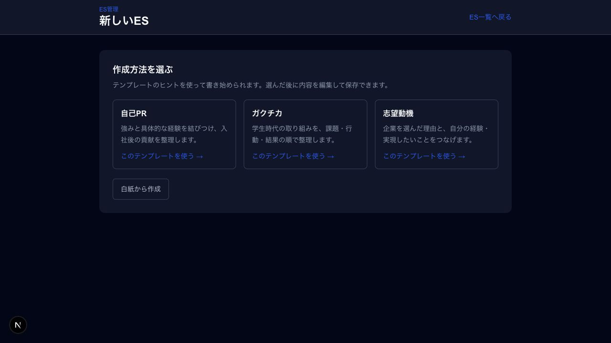
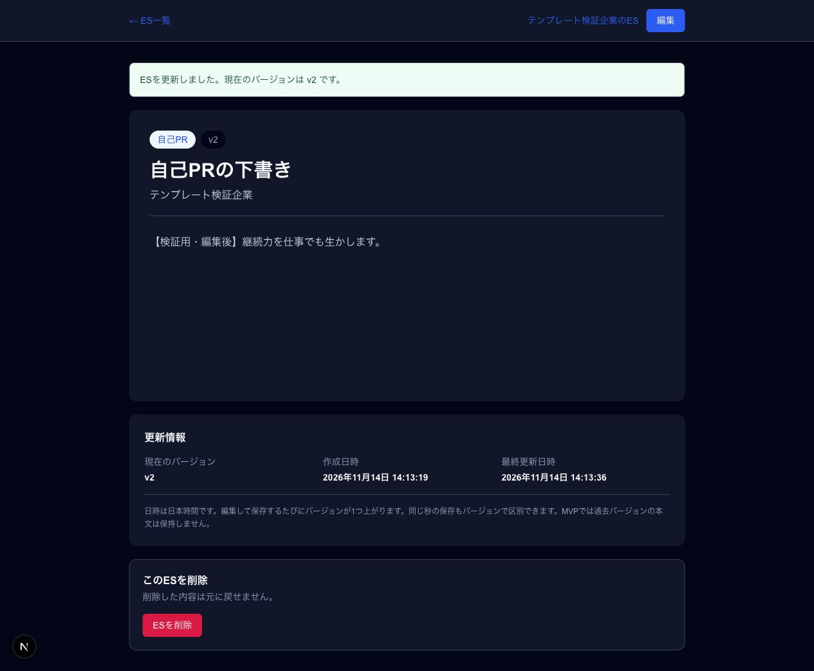

# ESテンプレート仕様・検証（#35）

## MVPの範囲

| テンプレート | doc_type | 内容 |
| --- | --- | --- |
| 自己PR | self_pr | 強み、経験、結果・学び、入社後の貢献 |
| ガクチカ | gakuchika | 取り組み、目標・課題、自分の行動、結果・学び |
| 志望動機 | motivation | 実現したいこと、きっかけ、企業を選ぶ理由、貢献 |

- 本文は回答例ではなく、本人の経験を書き込むための見出しとヒント。選択時にタイトル・文書種別・本文を初期入力する。
- `/es/new` で選択し、企業と内容を確認して「下書きを保存」する。選択だけではDBへ書き込まない。
- 「白紙から作成」も提供し、初期種別は `entry_sheet`。選択後も文書種別は通常のESと同じ5種類から変更できる。
- 企業詳細・企業フィルターから渡した所有企業IDを選択画面→フォームへ引き継ぐ。存在しない/他人の企業は初期選択しない。
- 不明なテンプレートIDでは選び直す案内を表示する。企業0件なら先に企業登録を案内する。
- 保存は #34 の通常の作成処理を共有する。企業所有権と入力をサーバーで検証し、`es_documents` に新しいID・version 1で保存する。
- コピーするのは文字列の値。保存・編集で元テンプレートや他の複製ESを変更しない。本文を後から自動同期しない。
- 新規保存エラーは同じ画面に表示し、企業・文書種別・タイトル・本文を保持する。送信中は保存ボタンを無効化する。

## #19 / #21との責務分担

- #35ではアプリ共通の固定3種類を `app/src/lib/es-templates.ts` で管理する。既存 `templates` テーブルは必須の `workspace_id` を持つ利用者所有の保存領域なので、共通テンプレートをそこへユーザーごとに登録する処理は加えない。今回、テンプレート用の追加マイグレーションは不要。
- #19の `es_documents` は `company_id`、`title`、`doc_type`、`content` を受け取り、#34と同じRLS・企業所有権を使う。ES本文はプレーンテキストとして保存する。
- #21が担当するページ/ブロック、利用者独自テンプレートの作成・保存・編集・一覧は今回の対象外。独自ESテンプレートを追加する場合は `templates.template_type = 'es'`、`content` のJSONに `{title, doc_type, content}`（本文は文字列）を持たせる方針とし、所有workspaceの検証後にES入力へコピーする。ページのブロックJSONをそのままES本文へ保存しない。
- #21全体の完成は #35の固定テンプレート導線の前提にしない。独自テンプレートやページ→ES変換の実装・結合確認は [#21](https://github.com/team-diamond-2026/jobhunt_notion_dev_memo/issues/21) で追跡する。

## 自動確認（2026-11-14）

`cd app && npm run test:es` で12テスト成功。`npm run lint`、`npm run build` も成功。

- PGliteへ実際の #19スキーマ/RLS、version更新、ES権限修正SQLを適用する。
- 実際の新規ページ・フォームをReactで描画し、3種類の初期本文/種別、企業引継ぎ、白紙、不明ID、他人の企業IDを確認する。
- 各テンプレートから通常のServer Actionで2件ずつ作成。異なるID、正しい企業/doc_type/本文、v1をDBで照合する。
- 片方を編集保存し、DB再取得・一覧/詳細再描画でv2と変更本文を確認。もう片方と元テンプレートは不変で、新規画面にも初期本文を表示する。
- 入力不備、不正種別、他人の企業、INSERT権限不足の失敗では行が増えず、入力内容を返す。
- 既存の更新日時・版番号・他ユーザーへのRLS遮断テストも継続成功。

## ブラウザ操作確認（2026-11-14）

Chromiumベースのアプリ内ブラウザ、通常のNext.jsアプリ/Supabase SDK/Server Actionsを使用。アプリをローカルの検証用コピーで起動し、接続先だけループバックのAuth/PostgREST互換fixture＋PGliteへ変更した。実Supabase、実アカウント、本番データは使用・変更していない。fixtureの認証は実Supabase Authの検証を代替しない。

| 手順 | 結果 |
| --- | --- |
| 企業ID付き新規画面→自己PRを選択 | 企業選択、自己PR種別、タイトルと初期本文を表示 |
| 本文を書き換えて保存 | 詳細へ遷移、v1、同じ企業と自己PR種別を表示。INSERT 1行 |
| 詳細→編集→保存→再読み込み→一覧 | 編集本文を保持、v2、一覧にも同じ本文・企業・種別。PATCH 1行 |
| 新しいES→再度自己PRを選択 | 元のヒント本文を表示し、既存ESの編集内容とは独立 |
| 企業/種別/タイトル/本文を入力し、fixtureのINSERTを503にして保存 | エラーを表示。4項目の入力をすべて保持 |
| fixtureを復旧し、入力を変えず再送信 | 保存成功、v1。企業・変更した種別・タイトル・改行を含む本文がDBと一致 |

保存した合成データの例: `self_pr` / 「自己PRの下書き」 / v2 / 「【検証用・編集後】継続力を仕事でも生かします。」。別ESは `other` / 「保存失敗からの再送信」 / v1。どちらも検証専用企業へ紐付き、fixtureのDB読取りで照合した。

## 対象Supabaseで残る確認

実環境は #39の確認で `es_documents` の権限不足（42501）が判明しており、管理者による [PR #66](https://github.com/team-diamond-2026/jobhunt_notion_dev_memo/pull/66) のSQL適用待ち。このPRは #66をベースにし、#35だけの差分を分けている。#66のマージ後にベースをmainへ変更する。

1. 管理者が [ES更新状態の検証](./17_ES更新状態の検証.md#管理者への依頼内容) に従って不足マイグレーションを適用し、読取り専用チェック8項目がtrueになることを確認する。
2. テストアカウントで企業を用意し、3種類のテンプレートそれぞれから保存→編集→再読み込み→一覧/詳細確認を行う。
3. 同じテンプレートを再度開き、元の本文が保持されることを確認する。保存された企業/doc_type/content/versionをDBと照合する。
4. 結果をIssueまたはPRへ追記する。実環境確認が終わるまで #35をcloseしない。
