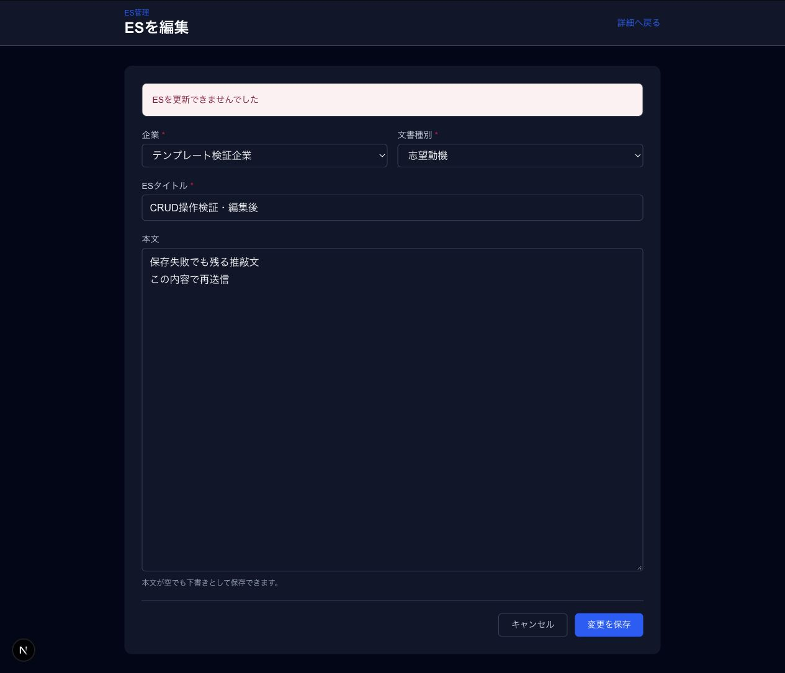
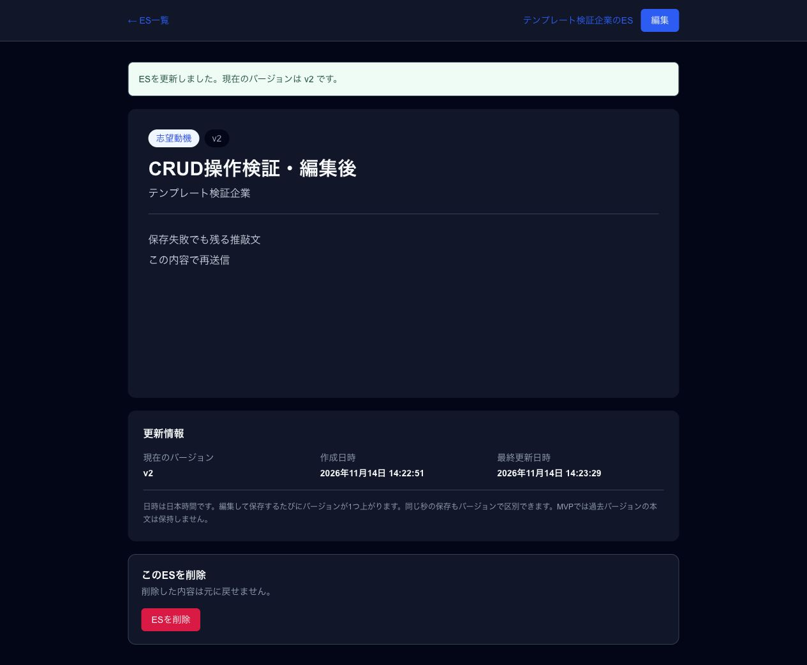

# ES CRUD検証（#34）

## 実装状況

基本の一覧・企業フィルター・新規作成・詳細・編集・削除は [PR #60](https://github.com/team-diamond-2026/jobhunt_notion_dev_memo/pull/60) でマージ済み。今回は以下を補う。

- 編集エラー時にリダイレクトして入力を失っていた処理を、入力値を保持するフォーム状態へ変更。企業・文書種別・タイトル・本文を再入力せず再送信できる。
- 新規作成と編集の保存状態の型・入力保持処理を共通化。編集の送信中も保存ボタンを無効化する。
- 削除後に一覧だけでなく、対象の詳細・編集パスも再検証対象にする。
- 通常のServer Actionsと実SQL/RLSを使い、作成から企業別再表示・編集・削除までの検証を追加する。

## 自動検証（2026-11-14）

`cd app && npm run test:es` で17テスト成功。`npm run lint`、`npm run build`、`git diff --check`も成功。

PGliteへ #19のスキーマ/RLS、#39のversion更新とESテーブル権限の実SQLを適用する。通信とSupabase管理のauthオブジェクトはテスト用の代替。画面は実際のページ/フォームをReactで描画する。

| 確認 | 結果 |
| --- | --- |
| 白紙から新規保存 | 本文空の下書きも企業に紐付いて保存し、一覧・編集画面で再取得できる |
| 企業フィルター | 対象企業の一覧にだけESを表示。別企業のフィルターには出ない |
| 企業変更・本文編集 | 自分の別企業へ移動すると旧企業一覧から消え、新企業一覧・詳細・編集画面に反映。繰り返し再取得しても保持 |
| 入力不備・更新失敗 | エラーと全入力値を返し、DB本文・企業・version・日時は不変 |
| 他ユーザーのアクセス | 一覧には出ず、詳細・編集はnot found。実際の更新Actionで自分の企業へ付け替える操作も拒否、削除Actionも拒否。元データ不変 |
| 削除失敗 | DELETE権限を外したテストDBでエラーを返し、元データは残る |
| 削除成功 | 実際の削除Actionで対象の1件だけ消え、再取得後の一覧には表示されず、詳細・編集はnot found。削除済み案内の描画と二重削除時のエラーも確認 |
| 未認証 | 一覧・詳細・編集・新規ページ、作成・更新・削除Actionのすべてがログインへ遷移 |

既存の3種類のテンプレート、v1→v2→v3、最終更新日時、RLSテストも継続成功している。

## ブラウザ操作確認（2026-11-14）

通常のNext.js画面/Supabase SDK/Server Actionsをローカルコピーで起動し、接続先だけループバックのAuth/PostgREST互換fixture＋PGliteへ変更。すべて合成データで、実アカウント・本番データは不使用/未変更。

1. 白紙作成で「CRUD操作検証」、エントリーシート種別、検証用企業、本文「編集前の合成データ」を保存。詳細にv1で表示。
2. 編集画面でタイトルを「CRUD操作検証・編集後」、種別を志望動機、本文を改行付きの推敲文へ変更。
3. fixtureのPATCHだけを503にして保存。エラー表示と企業・種別・タイトル・本文の保持を確認。DB読取りでは変更前の値とv1が残っていた。
4. fixtureを復旧し、入力を変えず再送信。詳細にv2で表示。再読み込み後も変更内容が保持されることを確認。

削除・他ユーザー操作拒否は上記のDB付き自動テストで確認したもので、今回のブラウザ操作や実Supabaseで実施したものではない。

## 残る実環境確認とPR順序

- この変更は #35の [PR #67](https://github.com/team-diamond-2026/jobhunt_notion_dev_memo/pull/67) をベースにする。#66（ES権限/検証基盤）→#67（テンプレート/新規保存状態）→今回のPRの順でマージし、先行PRのマージ後にベースをmainへ変更する。
- 対象Supabaseは `es_documents` の権限不足（42501）が判明しており、管理者のSQL適用待ち。[管理者向け手順](./17_ES更新状態の検証.md#管理者への依頼内容) で不足分を適用し、8項目のチェックを実施する。
- 適用後、テスト用の企業・ESで作成→企業別一覧→詳細→編集→再読み込み→削除→一覧/旧URLを確認し、別テストユーザーからの参照/更新拒否とともに結果をIssueまたはPRに追記する。削除には検証専用の使い捨てESだけを使用する。
- 自動テスト/fixtureは対象Supabaseの適用・認証・実データ確認を代替しない。実環境確認完了までは #34をcloseしない。
