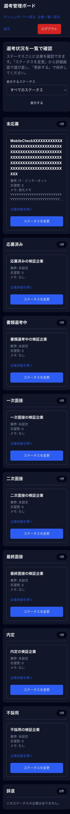
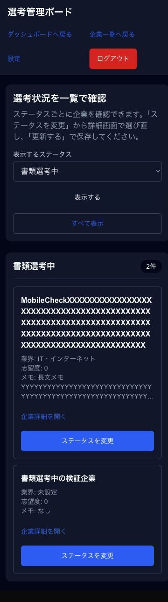
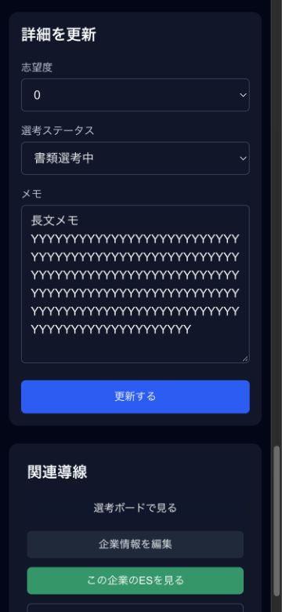

# 選考ボードのモバイル確認（#33）

## 表示・操作方針

- 768px未満はステータスごとに1列で縦に並べる。9ステータスをすべて表示し、0件の列も省略しない。768px以上は320px幅の9列をボード領域内で横スクロールする。
- 「表示するステータス」から1列に絞り込める。条件はURLの `status` に保持し、「すべて表示」で選択欄と表示をともに解除する。不正な条件は全件表示に戻す。
- カードの「企業詳細を開く」は詳細の先頭へ、「ステータスを変更」は既存の詳細フォーム `#company-update` へ移動する。詳細の選択欄で状態を選び、「更新する」で保存する。ドラッグ操作は不要。
- ボード・詳細のヘッダーを折り返し、長い英数字の企業名/メモも画面内に収める。選択欄、主要な導線、更新ボタンは高さ44px以上にする。
- 詳細ヘッダーからボードに戻れる。保存成功後はボードも再検証対象とし、戻ったときに変更後の列へ表示する。

## 保存先と関連Issue

- 正本は現行の `companies.selection_status`。新たな保存経路を追加せず、#12の詳細フォームと `updateCompany` を利用する。
- 認証、企業所有者、許可ステータス、前の段階への移動禁止は既存サーバー処理で検証する。既存の企業名/業界/志望度/メモも同じフォームから保存する。
- `applications` への履歴追加は行わない。詳細の進捗表示は保存された履歴ではなく、現在のステータスを表示する既存機能。
- `not_entered` 等の旧値は共通の `normalizeSelectionStatus` を使ってボード・詳細で日本語表示する。閲覧だけではDBを書き換えない。
- #32の保存方針・ステータス定義に変更が入る場合は、共通ヘルパーと既存フォームを同時に整合させる。この変更は独自の遷移規則を追加しない。
- #31のドラッグ実装は今回の前提にしない。#31がボードを変更した場合は、この代替導線を保持し、以下の確認をやり直す。

## 検証環境（2026-11-14）

- Next.js 16.2.6のproduction buildを `next start` で起動し、Chromiumベースのアプリ内ブラウザで操作した。
- 通常のSupabase SDK/Server Actionsを利用し、接続先だけループバックのAuth/PostgREST互換fixture＋PGliteに置き換えた。#19のスキーマ/RLSと業界カラムのマイグレーションを適用し、通常フォームのPATCHで保存した。固定プレビューや画面内だけの状態変更ではない。
- データは合成した8企業。1件は130文字の英数字企業名と150文字以上のメモ、7件は別ステータスに配置。辞退は0件。実アカウント・実Supabase・本番データは使用/変更していない。
- ブラウザの幅による表示・フォーム操作確認であり、iOS/Androidの実機タッチや実Supabase Auth、公開環境の確認ではない。これらは後続 #23で実施する。

## 画面幅・結果

| viewport | clientWidth / scrollWidth | 確認結果 |
| --- | --- | --- |
| 320×740（最終版の表示再確認は320×812） | 305 / 305 | 9ステータス・カードを1列表示。長い企業名を折り返し。詳細→変更保存→再読み込み→ボードで移動後の列を確認 |
| 375×812 | 360 / 360 | ボード・詳細で横はみ出しなし。絞り込み、詳細表示、変更保存、再読み込み、0件表示を確認 |
| 768×812 | 753 / 753 | ボード領域内の横スクロールへ切り替わり、ページ全体は横にはみ出さない |
| 1280×800 | 1265 / 1265 | 9列すべて320px幅で横並び。横スクロールはボード領域に限定 |

15px差は検証ブラウザの縦スクロールバー。375pxで0件だけを表示した画面は縦スクロール不要となり、375 / 375だった。フィルターのselect、詳細のステータスselectと更新ボタンはDOMの実測で高さ44px。

## 保存・再表示の実操作

1. 320pxで全9ステータスと8企業を表示。旧値 `not_entered` の企業も「未応募」列に表示。
2. 「ステータスを変更」から詳細フォームに移動し、「応募済み」を選んで「更新する」。PATCH 1行を確認。
3. 詳細を再読み込みし、ボードへ戻る。「未応募」は0件、「応募済み」は2件になり、保存した企業が移動していた。fixtureのDB読取りも `応募済み` と一致。
4. 検証データを再初期化し、375pxで「未応募」に絞り込み→「企業詳細を開く」。旧ステータスが詳細でも「未応募」と表示されることを確認。
5. 「書類選考中」を選んで保存。詳細を再読み込み→ボードへ戻る→「書類選考中」に絞り込み、対象企業と元からの企業の2件を確認。DBでも `書類選考中` を確認。
6. 詳細の選択欄では前段階の「未応募」「応募済み」が無効。既存の遷移制約を維持している。
7. 「辞退」に絞り込み、0件案内を確認。「すべて表示」で9列に戻り、選択欄も全ステータスに戻ることを確認。
8. 最終ビルドで320/375/768/1280pxの表示を再確認した。

## 静的検証と後続

- `npm ci`、`npm run lint`、`npm run build`、`git diff --check`: 成功。
- レイアウトの自動テストは追加せず、上記のブラウザ操作とDOM実測で検証した。fixtureは一時的な検証環境で、製品コードに認証を迂回するフラグは追加していない。
- #23で検証用Supabaseのテスト企業を使い、320/375px相当の実機と公開URLで同じ手順、ログアウト状態の遮断、別ユーザーの企業を変更できないことを確認する。
- #31のドラッグUI、#32の遷移規則、#49の共通ヘッダーを統合した場合も再確認する。今回のPRはmainをベースとし、ES関連PRには依存しない。
